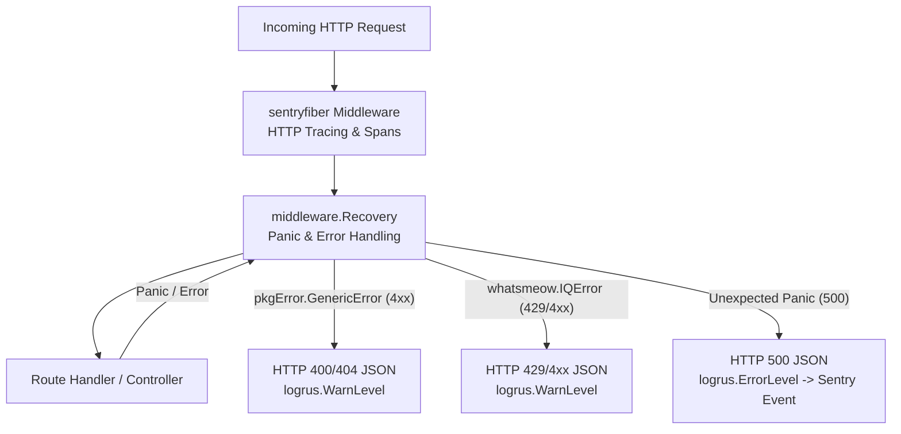

# Sentry Integration and Observability Guide

GOWA includes built-in observability with [Sentry](https://sentry.io) for error monitoring, performance tracing, and automated release tracking.

---

## 1. Configuration

Sentry monitoring is configured via environment variables or CLI flags and initialized during server startup in [`src/cmd/rest.go`](../src/cmd/rest.go):

| Setting | Env Variable | CLI Flag | Default | Description |
| :--- | :--- | :--- | :--- | :--- |
| **DSN** | `SENTRY_DSN` | `--sentry-dsn` | `""` | Sentry project DSN. Disabled if empty. |
| **Environment** | `SENTRY_ENVIRONMENT` | `--sentry-environment` | `"production"` | Target deployment environment name. |
| **Release** | `SENTRY_RELEASE` | `--sentry-release` | `AppVersion` | Release identifier (commit SHA in CI/CD). |
| **Traces Sample Rate** | `SENTRY_TRACES_SAMPLE_RATE` | `--sentry-traces-sample-rate` | `1.0` | Transaction sampling rate (0.0 to 1.0). |

---

## 2. Middleware & Error Handling Architecture

To prevent client errors and rate limits from generating false-positive 500 crashes and alerting Sentry, GOWA uses a layered pipeline:



### Handled Error Types

1. **`pkgError.GenericError`**: Client-side validation errors (`pkgError.ValidationError`), not found errors (`pkgError.NotFoundError`), and invalid JIDs (`pkgError.InvalidJID`).
   * Returns: HTTP `400` / `404`.
   * Logged at: `WarnLevel` (does not alert Sentry).
2. **`*whatsmeow.IQError`**: Info query errors returned by WhatsApp servers.
   * Status 429 (`rate-overlimit`): Returns `HTTP 429 Too Many Requests` (`RATE_OVERLIMIT`).
   * Status 404 (`item-not-found`): Returns `HTTP 404 Not Found`.
   * Status 401 / 403: Returns `HTTP 401/403 Not Authorized`.
   * Logged at: `WarnLevel` (does not alert Sentry).
3. **`sentry.BeforeSend` filter**:
   * Inspects both `hint.OriginalException` and `hint.RecoveredException`. Any error with status `< 500` is dropped before leaving the application.

---

## 3. Release Publication & Auto-Closing Issues

Deployments on the `main` branch automatically publish new releases to Sentry via `.github/workflows/deploy.yml`:

1. **Build Stamping:** The Go binary is compiled with the git commit SHA:
   ```bash
   go build -ldflags "-X github.com/aldinokemal/go-whatsapp-web-multidevice/config.SentryRelease=${{ github.sha }}" -o whatsapp .
   ```
2. **Action Release:** Uses `getsentry/action-release@v3` with `set_commits: "auto"` to associate repository commits with the release.
3. **Auto-Closing Issues:** To resolve Sentry issues automatically when shipping a fix, include `Fixes <SHORT_ID>` or `Closes <SHORT_ID>` in the commit message:
   ```bash
   git commit -m "fix(group): handle rate limit 429 on group info

   Fixes GOWA-1"
   ```
